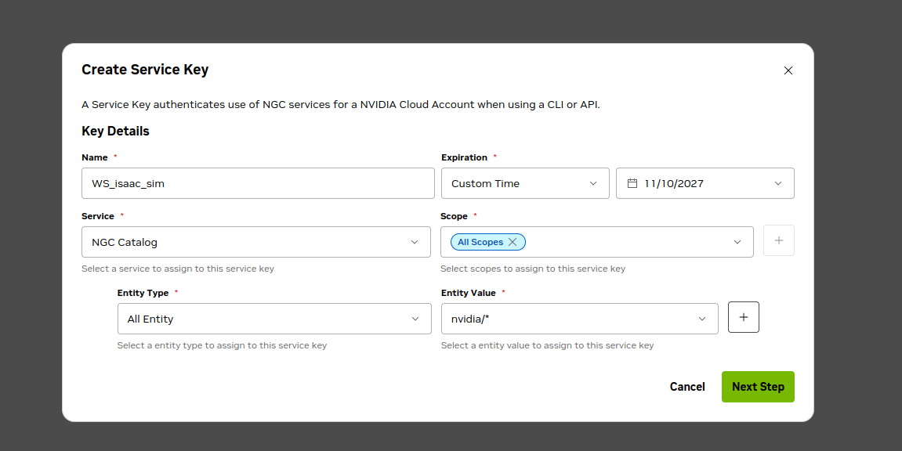

# Isaac Sim container: setup from scratch

Step-by-step guide for a fresh Ubuntu machine (22.04 or 24.04) with an NVIDIA RTX GPU and nothing else installed.
At the end you can run this repo's Python scripts inside Isaac Sim in a container.

**Requirements:** NVIDIA RTX GPU (with RT cores), about 40 GB free disk, internet access, a user with `sudo`.

## 1. Install the NVIDIA driver

Isaac Sim 6.0.1 needs driver version 570.169 or newer.

```bash
sudo ubuntu-drivers install
sudo reboot
```

After the reboot, check that it works:

```bash
nvidia-smi
```

You should see your GPU and a driver version of 570.169 or higher. If not, install a newer driver (e.g. `sudo apt install nvidia-driver-580`) and reboot.

## 2. Install Docker Engine

```bash
sudo apt-get update
sudo apt-get install -y ca-certificates curl git
sudo install -m 0755 -d /etc/apt/keyrings
sudo curl -fsSL https://download.docker.com/linux/ubuntu/gpg -o /etc/apt/keyrings/docker.asc
sudo chmod a+r /etc/apt/keyrings/docker.asc
echo "deb [arch=$(dpkg --print-architecture) signed-by=/etc/apt/keyrings/docker.asc] https://download.docker.com/linux/ubuntu $(. /etc/os-release && echo $VERSION_CODENAME) stable" | sudo tee /etc/apt/sources.list.d/docker.list > /dev/null
sudo apt-get update
sudo apt-get install -y docker-ce docker-ce-cli containerd.io docker-buildx-plugin docker-compose-plugin
```

Allow your user to run Docker without `sudo`:

```bash
sudo usermod -aG docker $USER
```

**Log out and back in** (or reboot), then check:

```bash
docker run --rm hello-world
docker compose version
```

## 3. Install the NVIDIA Container Toolkit (GPU access in Docker)

```bash
curl -fsSL https://nvidia.github.io/libnvidia-container/gpgkey | sudo gpg --dearmor -o /usr/share/keyrings/nvidia-container-toolkit-keyring.gpg
curl -s -L https://nvidia.github.io/libnvidia-container/stable/deb/nvidia-container-toolkit.list | sed 's#deb https://#deb [signed-by=/usr/share/keyrings/nvidia-container-toolkit-keyring.gpg] https://#g' | sudo tee /etc/apt/sources.list.d/nvidia-container-toolkit.list
sudo apt-get update
sudo apt-get install -y nvidia-container-toolkit
sudo nvidia-ctk runtime configure --runtime=docker
sudo systemctl restart docker
```

Check that containers can see the GPU:

```bash
docker run --rm --gpus all ubuntu nvidia-smi
```

This should print the same GPU table as step 1.

## 4. Get access to the Isaac Sim image (NGC)

The base image is hosted on NVIDIA NGC and needs a free account.

1. Create an account at https://ngc.nvidia.com and open Setup → API Keys → **Generate Service Key** (a Personal Key also works).
2. Fill in the form exactly like this, then click the **+** next to Entity Value so the entity is added, and click **Next Step**:

   

   | Field | Value |
   |-------|-------|
   | Name | any name, e.g. `isaac_sim` |
   | Expiration | 12 months (or as you like) |
   | Service | NGC Catalog |
   | Scope | Get Container |
   | Entity Type | All Containers |
   | Entity Value | `nvidia/*` |

3. **Copy the key right away.** It is only shown once.
4. Log in to the registry:

```bash
docker login nvcr.io
```

   - Username: `$oauthtoken` (type it literally, including the `$`; do **not** use your email)
   - Password: the key you copied (nothing is shown while you paste, that is normal)

   You should see `Login Succeeded`. The warning about unencrypted credentials is harmless on a personal machine.

## 5. Download this repo

```bash
git clone <REPO_URL> isaac_sim_synthetic_lidar_data
cd isaac_sim_synthetic_lidar_data
```

Replace `<REPO_URL>` with this repo's clone URL. All following commands are run from this folder.

## 6. Create the cache folders

Isaac Sim keeps shader caches, logs and config outside the container so they survive restarts. The container runs as uid 1234, so the folders must be writable by everyone:

```bash
mkdir -p ~/docker/isaac-sim/{cache/main,cache/computecache,logs,config,data,pkg}
chmod -R a+rwX ~/docker/isaac-sim
```

If you skip this, Docker creates the folders as root and Isaac Sim will fail with permission errors.

## 7. Build the image

```bash
docker compose build
```

The first build downloads the Isaac Sim base image (about 20 GB) and takes a while. The result is tagged `isaac-sim-stages:dev`.

To use a different Isaac Sim version, set `ISAAC_SIM_IMAGE`:

```bash
ISAAC_SIM_IMAGE=nvcr.io/nvidia/isaac-sim:5.1.0 docker compose build
```

## 8. Start the container

```bash
docker compose run --rm sim
```

You get a zsh shell in `/workspace`, which is this repo mounted into the container. Edits you make on the host show up immediately, and files the container writes appear on the host.

## 9. Run a script

Inside the container shell:

```bash
/isaac-sim/python.sh capture_one_scan.py \
    --usd Simple_Room/OS1_LiDAR_in_Simple_Room.usd --sensor /Root/OS1/sensor \
    --out scan_0000.pcd --headless
```

Or without opening a shell, from the host:

```bash
docker compose run --rm sim /isaac-sim/python.sh capture_one_scan.py --headless ...
```

The first Isaac Sim start is slow (shader compilation, several minutes). Later runs reuse the cache from step 6.

## What gets mounted

| Host | Container | Purpose |
|------|-----------|---------|
| `.` (repo) | `/workspace` | Your scripts and stages |
| `./container_config/.zshrc` | `/isaac-sim/.zshrc` (read-only) | Shell config; edit on the host, no rebuild |
| `~/docker/isaac-sim/*` | `/isaac-sim/.cache`, `.nv`, `.nvidia-omniverse`, `.local/share/ov` | Persistent caches, logs, config |

## Customising

- **Extra apt packages:** add them to the `apt-get install` list in the `Dockerfile`, then `docker compose build`.
- **Extra Python packages:** add `RUN /isaac-sim/python.sh -m pip install <pkg>` to the `Dockerfile`, then rebuild.
- **Shell config:** edit `container_config/.zshrc`; it applies to the next shell.

## Troubleshooting

| Problem | Fix |
|---------|-----|
| `permission denied ... docker.sock` | Step 2: add your user to the `docker` group, then log out and back in |
| `pull access denied` / `unauthorized` for `nvcr.io` | Step 4: log in with `docker login nvcr.io` |
| `could not select device driver "nvidia"` | Step 3: install and configure the NVIDIA Container Toolkit, restart Docker |
| Permission errors on cache or log folders | Step 6: re-run the `chmod -R a+rwX ~/docker/isaac-sim` command |
| Shell is bash instead of zsh | `command:` in `docker-compose.yml` must be `zsh` (it overrides the Dockerfile `CMD`) |
| `Error response from daemon: ... unauthorized` on login | Username must be `$oauthtoken`, not your email; check the key's scope (step 4) |
| Driver too old | Step 1: install a driver of 570.169 or newer |
